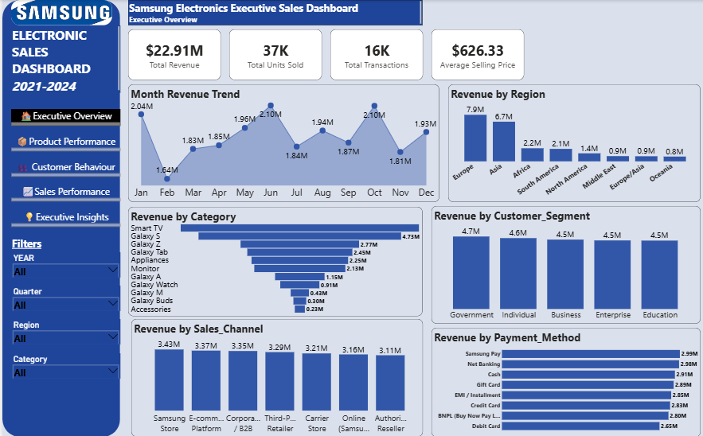
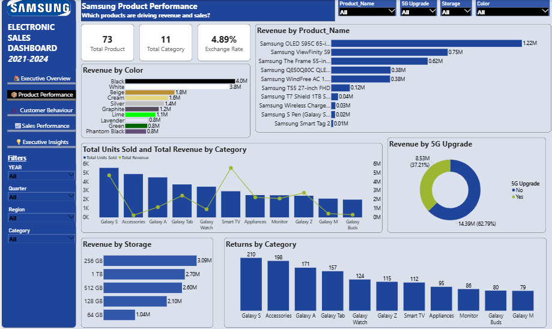
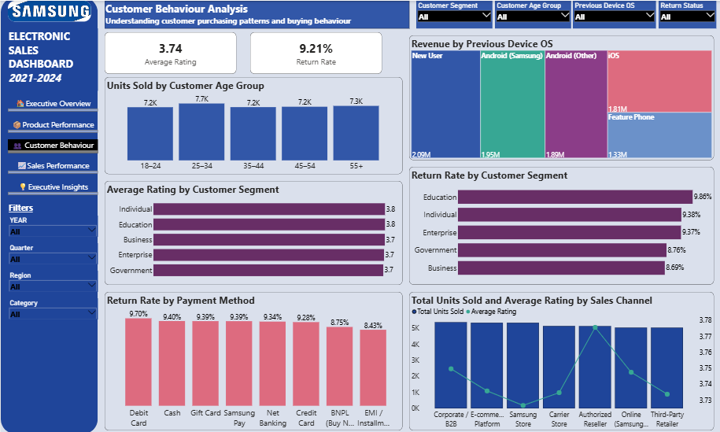
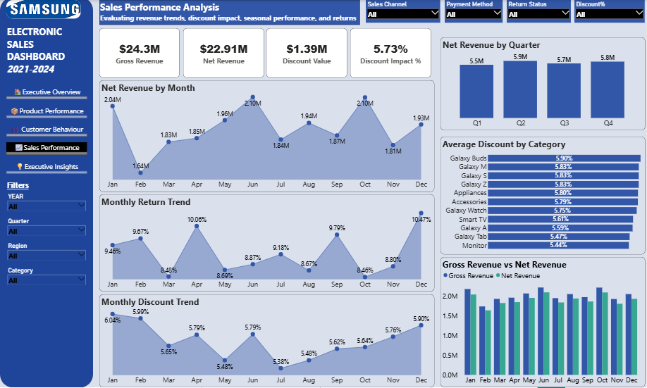
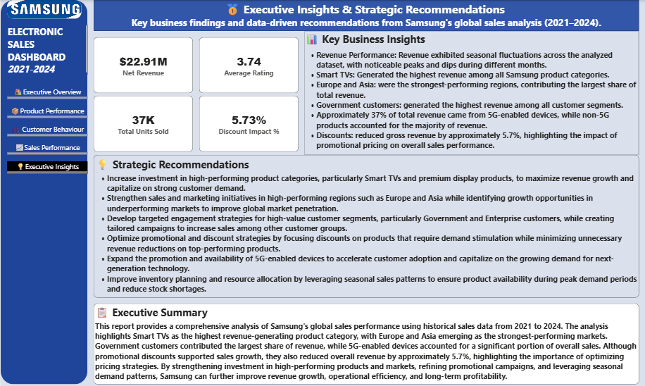

# Samsung Sales Performance Analysis

An interactive Microsoft Power BI report exploring Samsung sales performance from 2021–2024, with views of executive KPIs, product performance, customer behaviour, sales trends, and business recommendations.

## Project Overview

This five-page report uses interactive visualizations to explore revenue performance, product and customer patterns, discounts, returns, and regional trends.

**Tools:** Microsoft Power BI Desktop

## Featured Dashboard: Executive Overview



The Executive Overview brings together the main performance indicators and supporting views across months, regions, product categories, customer segments, sales channels, and payment methods.

Headline metrics shown in the report include:

- **$22.91M** net revenue
- **37K** total units sold
- **16K** total transactions
- **$626.33** average selling price

## Explore the Other Dashboard Pages

The report also includes four detailed pages. Expand a section below to view each dashboard.

<details>
<summary><strong>Product Performance</strong></summary>



Explores revenue by product, colour, storage, and 5G upgrade status, along with units sold and revenue by category and returns by category.

Metrics displayed include **73 total products**, **11 total categories**, and a **4.89% exchange rate**.

</details>

<details>
<summary><strong>Customer Behaviour</strong></summary>



Examines customer age groups, previous device operating systems, ratings by customer segment, return rates, payment methods, and sales channels.

Headline metrics shown are **3.74 average rating** and **9.21% return rate**.

</details>

<details>
<summary><strong>Sales Performance</strong></summary>



Tracks monthly net revenue, return trends, discount trends, quarterly net revenue, average discounts by category, and gross revenue compared with net revenue.

Headline metrics shown include **$24.3M gross revenue**, **$22.91M net revenue**, **$1.39M discount value**, and **5.73% discount impact**.

</details>

<details>
<summary><strong>Executive Insights & Strategic Recommendations</strong></summary>



Summarizes the report's key findings and recommendations related to product investment, regional growth, customer engagement, discount strategy, 5G-enabled devices, and inventory planning.

</details>

## Key Findings

The report's Executive Insights page highlights the following:

- **Product category:** Smart TVs generated the highest revenue among the categories shown.
- **Regional performance:** Europe and Asia were identified as the strongest-performing regions.
- **Customer segment:** Government customers were identified as generating the highest revenue.
- **5G-enabled devices:** Approximately 37% of total revenue was attributed to 5G-enabled devices.
- **Discounts:** The report indicates a discount impact of approximately 5.7%.
- **Seasonality:** Monthly revenue fluctuated across the period analyzed.

The project author has confirmed that the calculations have been validated. The findings above describe the analysis presented in the Power BI report.

## Dataset

The dataset used for this project was obtained from Kaggle.

## How to View the Project

1. Download `Samsung Sales Performance.pbix` from this repository.
2. Open it in Microsoft Power BI Desktop.
3. Navigate through the report pages and interact with the available filters and visuals.

Refreshing the report may require the original dataset or a configured data connection.

## Repository Structure

```text
Samsung-Sales-Performance/
├── Samsung Sales Performance.pbix
├── screenshots/
│   ├── 01-executive-overview.png
│   ├── 02-product-performance.png
│   ├── 03-customer-behaviour.png
│   ├── 04-sales-performance.png
│   └── 05-executive-insights.png
├── .gitignore
└── README.md
```

## Notes

This project is presented for portfolio and learning purposes.
